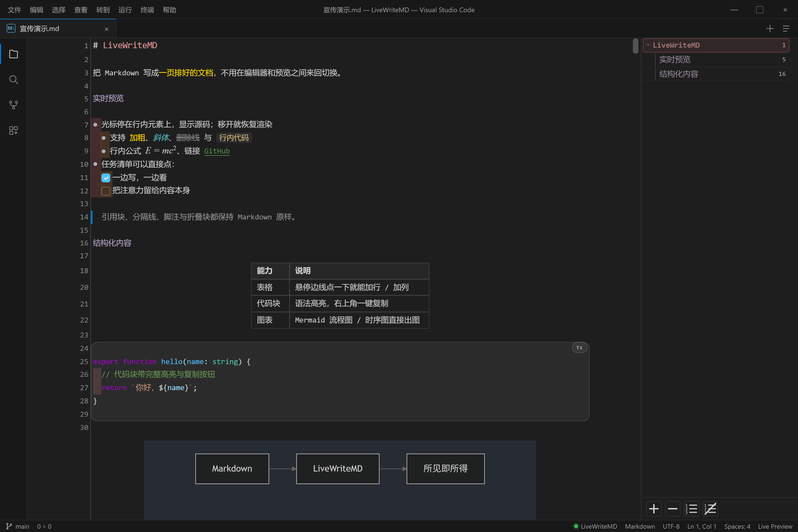
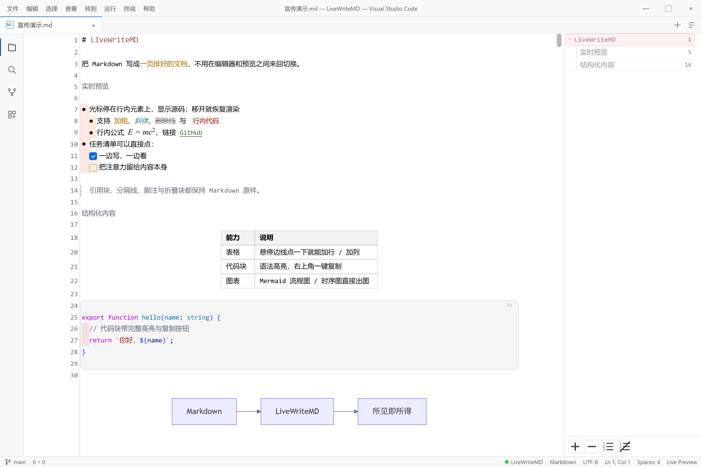
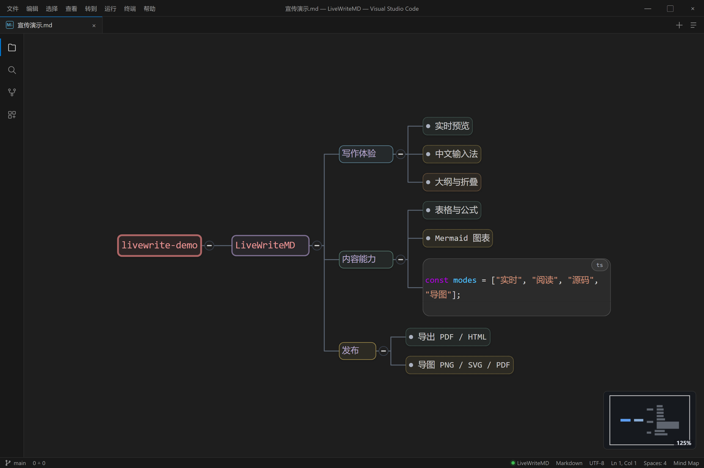
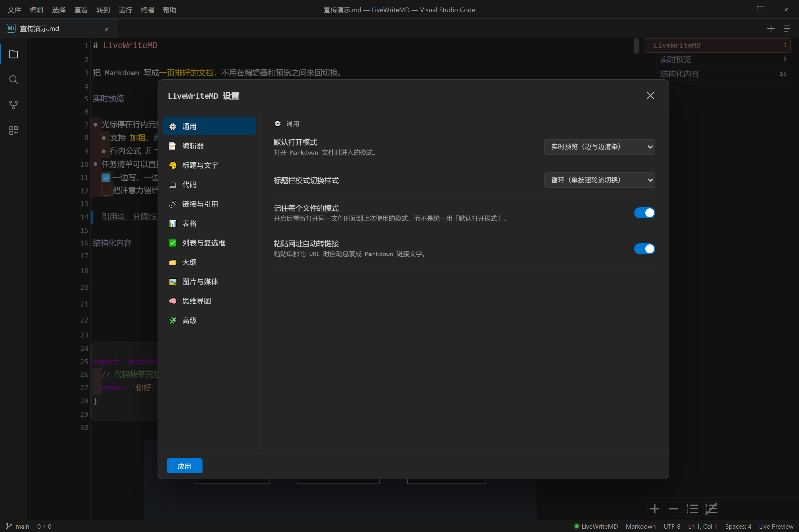
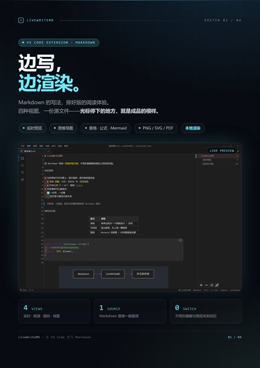
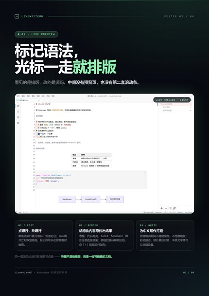
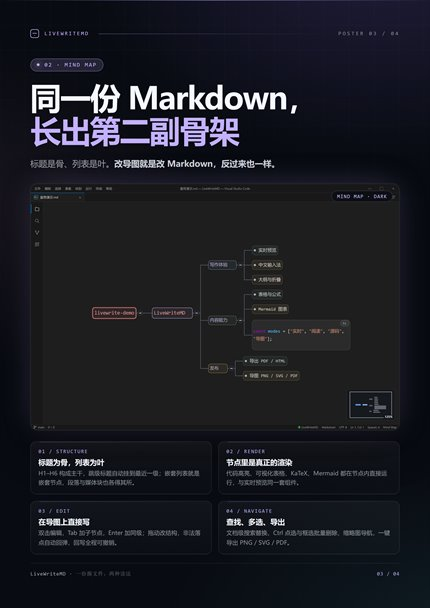
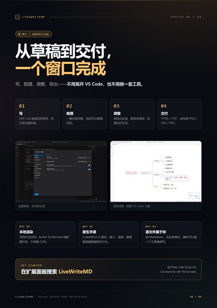

# LiveWriteMD

<p align="center">
  <b>在 VS Code 里，把 Markdown 写成一份排好的文档。</b><br>
  实时预览 · 思维导图 · 表格 / 公式 / 图表 · 完整中文输入 · PDF / HTML 导出
</p>

<p align="center">
  
</p>

<p align="center">
  
  
  
  
</p>

---

LiveWriteMD 把「实时预览（Live Preview）」搬进了 VS Code：你敲下的 Markdown 标记，在光标离开的瞬间变成最终排版；想改的时候点回去，那一行又变回源码。不需要在「编辑器」和「预览页」两个标签之间来回切换。`.md` 文件默认直接用 LiveWriteMD 打开。

它同时提供**四种视图**：实时预览、阅读、源码，以及一张由同一份 Markdown 直接长出来的**思维导图**。

## 为什么不是「分屏预览」？

|  | 传统「编辑器 + 预览」分屏 | LiveWriteMD |
| --- | --- | --- |
| 视线 | 左边写、右边看，来回找位置 | 排版就在光标所在处，所见即所在 |
| 修改 | 预览区只读，要回源码区找对应行 | 点哪一行，哪一行就地展开源码 |
| 表格 | 手改竖线、数格子对齐 | 可视化表格，点边线直接加行 / 加列 |
| 图表 | 预览里是一张静态图 | 原位渲染，可放大，可在右栏改源码 |
| 长文档 | 两套滚动条、两套定位 | 同屏 + 大纲 + 折叠 + 导图，一套位置 |

## ✨ 一眼看完

| 能力 | 你能得到什么 |
| --- | --- |
| **真·所见即所得** | 标记符号实时淡入淡出，排版结果就是最终文档；点击即改，双击把源码行「钉」住 |
| **思维导图** | 标题为骨、列表为叶，代码 / 表格 / 公式 / Mermaid / 图片作为完整渲染的媒体节点 |
| **结构化渲染** | 表格、代码高亮、KaTeX、Mermaid、脚注、任务列表、折叠块、Frontmatter 全部原位渲染 |
| **中文写作友好** | 拼音组词期间不误触发装饰、不宽度跳变；彩虹缩进、悬挂对齐、中英文字体分开设置 |
| **应用内设置** | 几十项颜色 / 字号 / 排版 / 导图选项实时预览，自动保存，无需手写 `settings.json` |
| **本地导出** | 可独立分享的 HTML、所见即所得的 PDF，以及导图的 PNG / SVG / PDF |

---

## 🖥️ 实时预览：写的时候就是成品

<p align="center">
  
</p>

### 光标离开就渲染，点回来就是源码

- 光标停在行内元素上时显示 Markdown 源码，移开立即恢复排版。
- **单击**渲染行展开该行源码，**双击**把源码行钉住（设置里可关闭双击钉住）。
- 展开 / 收拢只影响显示，不改变文档内容；光标、撤销栈、滚动位置始终连续。
- 括号 / 引号自动配对，粘贴裸 URL 自动包成 Markdown 链接。
- 中文输入法（IME）组词期间不触发装饰重建，候选窗不会把排版顶跳。

### 原位渲染的 Markdown 元素

- **标题** H1–H6：字号与颜色可逐级定制，支持 ATX 与 setext 两种写法。
- **行内格式**：加粗、斜体（可选真斜体字形）、删除线、行内代码、行内公式。
- **链接**：`[文字](地址)`、裸 URL、空链接、本地文件路径；粘贴裸 URL 自动包成链接。
- **列表**：有序 / 无序 / 任务列表统一规则；续行悬挂缩进对齐内容列；**彩虹缩进色带**每级一色，连按 Tab 跳级也能正确补齐。
- **任务列表**：渲染成复选框，点一下即可勾选，源码同步更新。
- **引用块、分隔线、脚注、`<details>` 折叠块、YAML Frontmatter**：按原样渲染或折叠。
- **代码块**：数十种语言语法高亮，右上角一键复制。
- **数学公式**：行内 `$...$` 与块级 `$$...$$` 由 KaTeX 实时渲染。
- **Mermaid**：流程图、时序图、饼图等直接出图；右下角放大按钮打开大图，并可在右栏直接修改源码。
- **图片**：自动居中、按文档宽度缩放，浮层上的 −/+ 可把显示宽度调成正文宽度的不同百分比。

### 表格：点一下边线就加行 / 加列

表格是可视化渲染的：表头底色、斑马纹、选中格子高亮。把鼠标移到**最右列的右边线**或**最底行的下边线**上，会出现一个「+」，点一下就在对应方向新增一列 / 一行。也可以右键表格，用菜单增删行列、调整对齐。

### 图片工作流

- `Ctrl+Shift+I` 插入图片文件。
- **粘贴 / 拖拽**图片自动保存到文档旁的 `assets` 目录（目录名可配置）并插入链接。
- 右键菜单可把文档里的**远程图片下载到本地** `assets`，方便归档与迁移。

### 大纲、折叠与搜索

- 右侧**大纲面板**层级展示全部标题，点击跳转，光标移动时自动高亮当前位置。
- 大纲宽度可拖拽调节并持久保存；支持缩进引导线、打开文件自动展开。
- **悬停行号显示折叠箭头**：标题按章节、列表按子项收起 / 展开；支持连续折叠；收拢行左缘有同色「角花」标识。
- `Ctrl+F` 查找、`Ctrl+H` 替换：支持正则、区分大小写、全词匹配，替换可一步撤销。

### 导出

- **Export as HTML**：生成单文件 HTML，排版样式内嵌；代码高亮与 Mermaid 通过 CDN 加载，图片沿用相对路径（连同 `assets/` 一起分享即可）。
- **Export as PDF**：调用本机 Edge / Chrome 无头打印，排版与编辑器内一致；浏览器路径可在设置中指定。

---

## 🧠 思维导图：同一份 Markdown 的第二副骨架

<p align="center">
  
</p>

点击标题栏的导图按钮，或在命令面板执行 `LiveWriteMD: 切换到思维导图`，当前文档就会变成一张可编辑的导图。**Markdown 始终是唯一的数据源**：导图上的每一次改名、拖动、增删，都会直接写回 `.md`。

### 它是怎么读你的文档的

- **虚拟根** = 文件名，不需要在文档里额外写根节点。
- **标题是骨**：H1–H6（含 setext 标题）构成主干；跳级标题自动挂到最近的更浅一级。
- **列表是叶**：有序 / 无序列表项成为子节点，嵌套列表就是嵌套节点。
- **段落是叶**：标题或列表项下的普通段落成为子节点；超过 50 字截断显示，悬停可看全文。
- **媒体是完整节点**：代码块、表格、数学块、Mermaid、独占段落的图片、YAML Frontmatter 都以媒体节点进入导图。
- **跳过非树内容**：引用块、HTML 块、分隔线不进入导图；行内公式、行内代码仍保留在节点文字里。
- 节点顺序严格等于源文档行号顺序；代码块里的「假标题 / 假列表」不会被误认。

### 节点里就是真正的渲染结果

每个节点内部是一份独立的迷你编辑器，跑的是**与实时预览同一套装饰与组件**，不是截图或缩略图：

- 标题层级、加粗 / 斜体 / 删除线 / 行内代码、链接、任务清单都能正常显示。
- 代码块带语法高亮与复制按钮；表格是可视化表格，同样可以点边线加行列、右键增删。
- Mermaid 原位出图，放大按钮会打开大图 + 右侧源码编辑栏；公式由 KaTeX 渲染。
- 在显示态直接调整 Mermaid 宽度、给表格加行列，改动会回写到 Markdown。

### 直接在导图上写

| 操作 | 效果 |
| --- | --- |
| 单击节点 | 选中；再点一次已选中的节点进入编辑 |
| 双击 / `F2` | 进入编辑，光标落在点击位置 |
| `Tab` | 新建子节点（文本节点） |
| `Enter` | 新建同级节点 |
| `Shift+Enter` | 提交当前编辑，并新起一个同级节点 |
| `Ctrl+B` / `Ctrl+I` / `Ctrl+G` | 加粗 / 斜体 / 行内代码 |
| `Ctrl+Z` / `Ctrl+Y` | 撤销 / 重做（走文档级撤销栈） |
| `Ctrl+F` / `Ctrl+H` | 查找 / 替换（与实时预览同一个搜索面板） |
| `Delete` / `Backspace` | 删除选中节点；有子节点时二次确认 |

节点悬浮工具条可以「＋子节点」「＋兄弟」：点按钮是普通文本，悬停还能选**标题（1–4 级）、表格（4×4 网格选尺寸）、代码块、公式、Mermaid、列表项**。媒体兄弟会按 Markdown 语义落在正确的父级下。

### 整理、导航与多选

- **拖动节点**改父子或排序；落点有插入指示线，拖动保持节点类型，非法落点自动回弹，也不能拖进自己的子树。
- **折叠 / 展开**：节点上的展开按钮、右键「全部展开」，默认展开层级可设（0 = 只显示根）。
- **多选**：`Ctrl` 点选多个节点，或 `Ctrl` 拖拽框选；批量删除前会显示数量并要求确认。
- **缩略图**：右下角 minimap 显示全图与当前视口，点击 / 拖动即可跳转。
- **平移与缩放**：拖拽空白处平移，滚轮缩放，右键「适应画布」一键入镜；从实时预览进入导图时定位到当前视口中部的节点（固定 100% 缩放），返回时回到导图里最后停留的节点。
- **导图内搜索替换**：支持正则、全词、大小写，替换是文档级的，一次回写 = 一步撤销。

### 独立导图面板

`LiveWriteMD: 在侧边打开思维导图` 会把当前文档的导图开到**编辑器右侧的独立面板**，一份文档最多一个面板。你可以左边写 Markdown、右边看导图，双向实时同步；面板里同样可以编辑、导出，撤销 / 重做走文档自己的历史记录。

### 导出导图

右键画布选择 **导出 PNG / SVG / PDF**：

- **PNG**：高分辨率位图，适合贴到聊天、文档、PPT。
- **SVG**：矢量图，放大不糊，适合印刷。
- **PDF**：单页高分辨率，适合直接分享与打印。

导图跟随当前明暗主题导出；导出范围是整棵树，与当前的缩放、平移无关。

---

## 🔁 四种视图

| 模式 | 说明 |
| --- | --- |
| **实时预览 Live** | 默认模式。边写边渲染，光标处显示源码，离开后自动排版 |
| **阅读 Viewer** | 只读渲染视图，适合审阅；复选框仍可点击 |
| **源码 Source** | 纯 Markdown 原文，等价于传统文本编辑器 |
| **思维导图 Mind Map** | 由同一份 Markdown 生成的树，可直接编辑并写回 |

标题栏的模式按钮可在「单按钮循环（实时 → 阅读 → 源码 → 导图）」与「直达按钮」两种样式间切换；也可以设默认模式、记住每个文件上次使用的模式。导图与文本模式之间切换时，会尽量把你送回同一个位置。

---

## 🎨 设置与个性化

<p align="center">
  
</p>

点击编辑器标题栏的齿轮，或执行 `LiveWriteMD: 设置`，打开应用内设置面板。所有改动实时生效、自动保存。设置按组组织：

- **通用**：默认模式、模式切换样式、记住每个文件的模式、智能 URL 粘贴。
- **编辑器**：行号、自动换行、正文最大宽度、行高、字号缩放、中英文字体、当前行高亮、空白字符。
- **标题与文字**：H1–H6 颜色与 H1 字号、加粗 / 斜体 / 删除线颜色、斜体真倾斜。
- **代码**：行内代码颜色 / 底色 / 字号，代码块底色与边线。
- **链接与引用**：链接、引用竖线与文字、分隔线颜色。
- **表格**：边框、表头、斑马纹、选中格子颜色。
- **列表与复选框**：圆点颜色与垂直偏移、复选框强调色。
- **大纲**：自动展开、默认宽度、缩进引导线。
- **图片与媒体**：保存目录、默认宽度、居中。
- **思维导图**：主题（跟随 / 浅色 / 深色）、默认展开层级、节点最大宽度与行数、视口按需渲染、离屏实例缓存、低倍缩放降级、纯文本缩放。
- **高级**：明暗主题、同步防抖、拖拽判定阈值、双击钉住、大文件阈值、PDF 浏览器路径、调试日志。

> 所有颜色项**留空即「自动」**——跟随 VS Code 当前明暗主题；选择颜色后才覆盖，随时可以改回。

---

## ⌨️ 快捷键

### 文本模式

| 快捷键 | 功能 |
| --- | --- |
| `Ctrl+Shift+I` | 插入图片 |
| `Ctrl+F` / `Ctrl+H` | 查找 / 替换 |
| `Ctrl+滚轮` | 正文字号缩放（自动保存） |
| 单击渲染行 | 展开该行源码 |
| 双击 | 钉住 / 取消钉住源码行 |
| 点击行号箭头 | 折叠 / 展开标题章节或列表子项 |
| 点击复选框 | 勾选任务项 |

### 思维导图

| 快捷键 | 功能 |
| --- | --- |
| `Tab` | 新建子节点 |
| `Enter` | 新建同级节点 |
| `Shift+Enter` | 提交并新起同级节点 |
| `F2` / 双击 | 编辑节点 |
| `Ctrl+B` / `Ctrl+I` / `Ctrl+G` | 加粗 / 斜体 / 行内代码 |
| `Ctrl+Z` / `Ctrl+Y` | 撤销 / 重做 |
| `Ctrl+F` / `Ctrl+H` | 查找 / 替换 |
| `Delete` | 删除节点（含子树时二次确认） |

更多命令在 `Ctrl+Shift+P` 命令面板输入 **LiveWriteMD**：

- `LiveWriteMD: 切换到实时预览 / 查看模式 / 源码模式 / 思维导图`
- `LiveWriteMD: 切换编辑模式`、`切换文本模式`、`切换思维导图`
- `LiveWriteMD: 在侧边打开思维导图`
- `LiveWriteMD: Export as HTML` / `Export as PDF`
- `LiveWriteMD: 显示/隐藏大纲`
- `LiveWriteMD: 设置`
- `LiveWriteMD: Insert Image`
- `Open with LiveWriteMD`（资源管理器右键 `.md`）

---

## 🚀 快速开始

1. 在扩展面板搜索 **LiveWriteMD** 安装（或按下面的 VSIX 方式安装）。
2. 打开任意 `.md` 文件——它默认就以实时预览打开。
3. 直接开始写；点标题栏齿轮调外观，点导图按钮换个视角，右侧大纲用于长文导航。

### 从 VSIX 安装

1. `Ctrl+Shift+P` → `Extensions: Install from VSIX...`
2. 选择 `livewrite-md<版本>.vsix`
3. 执行 `Developer: Reload Window` 重载窗口

### 系统要求

- VS Code **1.85** 或更高版本（桌面版）。
- Windows / macOS / Linux。
- PDF 导出需要本机安装 Edge 或 Chrome；未自动找到时可在设置里填写浏览器可执行文件路径。
- KaTeX、Mermaid、代码高亮均随扩展打包，渲染不依赖 CDN；只有加载远程图片时才需要网络。

---

## 🧭 适合谁

- **技术写作**：API 文档、设计文档、方案评审，代码块和表格是主角。
- **长期笔记**：一份 Markdown 既能逐字阅读，也能一眼看结构。
- **中文长文**：论文草稿、公众号、课程讲义，输入法和排版细节不添乱。
- **项目梳理**：把 README / 需求文档直接变成导图，讲给别人听。
- **离线环境**：内网、远程开发、飞机上，渲染与编辑都在本地完成。

---

## ❓ FAQ 与已知边界

**Q：导图会修改我的 Markdown 吗？**
会，而且这是设计目标。导图上的改名、增删、拖动都会写回源文件；Markdown 始终是唯一数据源。所有回写都走 VS Code 的文档编辑，支持文档级撤销。

**Q：为什么有些内容没有出现在导图里？**
引用块、HTML 块、分隔线不参与建树；段落节点超过 50 字会截断显示，悬停可看全文；Frontmatter 会作为根节点下的元数据节点出现。代码块、表格、数学块、Mermaid、图片都会以媒体节点出现。

**Q：导图 PDF 里的文字能选中 / 搜索吗？**
导图 PDF 是单页高分辨率位图，适合分享和打印；需要可缩放的矢量文字请导出 **SVG**。文本模式的「Export as PDF」走浏览器打印，文字是可选中、可搜索的。

**Q：导出 PDF 失败？**
扩展会自动探测 Edge / Chrome。探测不到时，在设置 → 高级 → PDF 浏览器路径里填写 `msedge.exe` / `chrome.exe` 的完整路径。

**Q：支持 Obsidian 的 `[[双链]]`、Callout、Dataview 吗？**
LiveWriteMD 按 CommonMark + GFM 解析。Obsidian 专属语法不会获得特殊渲染；`[[链接]]` 会按普通文字显示，`> [!note]` 会按普通引用块显示。

**Q：大文件会不会卡？**
超过阈值（默认 1 MB，可调，0 关闭）打开前会提示。导图默认开启「只渲染视口内节点」，并提供离屏缓存、低倍缩放降级、纯文本缩放等选项，用于几百个节点的大文档。若文档极大，建议先用源码模式或调低默认展开层级。

**Q：图片保存在哪里？**
粘贴 / 拖拽的图片默认存到文档同级的 `assets` 目录（可在设置里改目录名），插入的是相对路径。远程图片仍走网络；需要离线归档时用右键「下载远程图片」。

**Q：和 VS Code 自带的 Markdown 预览冲突吗？**
LiveWriteMD 注册为 `.md` 的自定义编辑器。若同时安装了其他 Markdown 扩展，可用「Reopen with...」或命令 `Open with LiveWriteMD` 指定用哪个打开。

**Q：会联网上传文档吗？**
不会。编辑、装饰、KaTeX / Mermaid 渲染都在本地 Webview 中完成。只有当你主动加载远程图片或执行“下载远程图片”时才会访问对应地址。

---

## 🛠️ 开发

```bash
pnpm install          # 或 npm install
pnpm build            # 打包扩展宿主 + webview
pnpm watch            # watch 模式持续构建
pnpm typecheck        # TypeScript 类型检查
pnpm lint             # ESLint
pnpm package:vsix     # 生成固定文件名的安装包 livewrite-md<版本>.vsix
```

技术栈：扩展宿主 TypeScript；Webview 为原生 DOM + CodeMirror 6（无前端框架）；导图使用自研画布引擎（平移层 + 缩放层、视口虚拟化、按 uid 复用节点、独立 mini-CM 渲染）；构建使用 esbuild。

## 🖼️ 宣传海报（A4）

四张 A4 竖版海报，可直接打印或导出 PNG 用于发布。HTML 源文件在 [`assets/posters/`](assets/posters/)，改完文案后用浏览器打印即可；下面点击缩略图查看 3× 分辨率成品（2382 × 3369）。

| 01 · 边写边渲染 | 02 · 实时预览 | 03 · 思维导图 | 04 · 工作流 |
| :---: | :---: | :---: | :---: |
| [](assets/posters/poster-01.png) | [](assets/posters/poster-02.png) | [](assets/posters/poster-03.png) | [](assets/posters/poster-04.png) |

## 🔗 仓库与反馈

- GitHub: [lyjy-kq/livewrite-md-forvscode](https://github.com/lyjy-kq/livewrite-md-forvscode)
- 问题与建议：[提交 Issue](https://github.com/lyjy-kq/livewrite-md-forvscode/issues)
- 宣传海报（A4，可直接打印或导出 PNG）：[assets/posters/](assets/posters/)

如果 LiveWriteMD 让你的写作顺手了一点，欢迎在 GitHub 点一个 ⭐。

## 🙏 致谢

实时预览的交互灵感来自 [Obsidian](https://obsidian.md/)；渲染能力来自 [CodeMirror 6](https://codemirror.net/)、[Mermaid](https://mermaid.js.org/) 与 [KaTeX](https://katex.org/)。感谢这些出色的开源项目。
